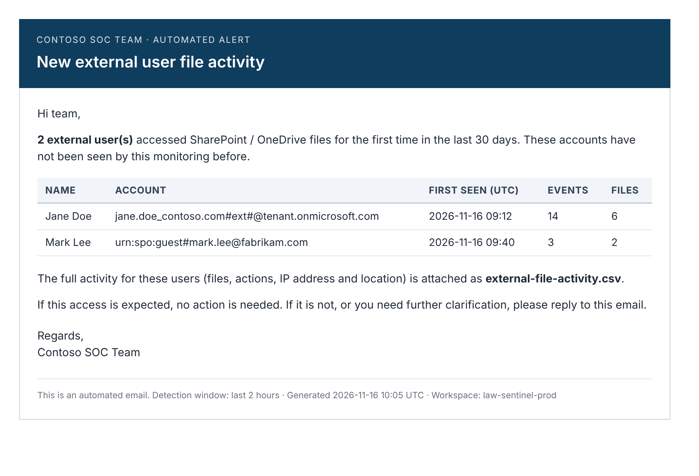

# External user file activity (SharePoint / OneDrive)

Two Logic App playbooks, deployed together from one ARM template (`azuredeploy.json`). The
template works in any tenant: it has no hard-coded subscription, resource group, workspace or identity.

| Playbook | Schedule | What it does |
|---|---|---|
| `<prefix>-ExternalFileActivity-WatchlistSync` | Every 12 h (configurable) | Finds every external / guest user with SharePoint, OneDrive or Office Online file activity in the last 30 days and upserts them into the `ExternalFileActivity` Sentinel watchlist (the "known external users" list). |
| `<prefix>-ExternalFileActivity-NewUserAlert` | Hourly | Finds external users whose **first** activity in the last 30 days happened in the last 2 hours, keeps only those **not already on the watchlist**, then sends the email, creates the Sentinel incident and adds them to the watchlist. Each user is alerted once. |

```
Defender XDR CloudAppEvents (Graph runHuntingQuery, managed identity)
            │
   ┌────────┴─────────────┐
   ▼                      ▼
WatchlistSync (12h)    NewUserAlert (1h)
   │  upsert rows         │  candidate not on watchlist?
   ▼                      ▼
 Sentinel watchlist ◄── add user after email + incident
 "ExternalFileActivity"   │
                          ├─► Email (Office 365 Outlook connector) + CSV of activity
                          └─► Sentinel incident (None / New / Closed)
```

## Authentication

| Call | Auth |
|---|---|
| Graph `security/runHuntingQuery` | User-assigned managed identity → Graph `ThreatHunting.Read.All` |
| Sentinel watchlists, watchlist items, incidents (ARM REST) | User-assigned managed identity → **Microsoft Sentinel Contributor** on the workspace |
| Email | Office 365 Outlook API connection (authorised once by the sending mailbox's user) |

The template doesn't create any Sentinel API connection: all Sentinel calls are plain HTTP using the managed identity.

## Deploy

1. **Deploy the template.** Use Azure portal → *Deploy a custom template* → *Build your own template* → paste `azuredeploy.json`. Or use the CLI:

   ```bash
   az deployment group create -g <playbook-rg> -f azuredeploy.json -p WorkspaceName=<sentinel-workspace> NotificationRecipients="soc@contoso.com" SocTeamName="Contoso SOC Team"
   ```

   The deploying account needs Contributor on the playbook resource group. If `AssignSentinelContributorRole=true`, it also needs Owner or User Access Administrator on the workspace.

2. **Grant the Graph permission.** Run as Global Administrator or Privileged Role Administrator, using the `managedIdentityPrincipalId` deployment output:

   ```powershell
   ./Grant-GraphPermissions.ps1 -ManagedIdentityPrincipalId <principalId>
   ```

3. **Authorise the Outlook connection.** Go to the resource group → API connection `office365-<prefix>-ExternalFileActivity` → *Edit API connection* → *Authorize* → sign in with the mailbox that should send the alerts (ideally a dedicated or service mailbox) → *Save*.

4. **Run `WatchlistSync` once by hand** (*Run trigger*). This builds the baseline before the first alert run. NewUserAlert only alerts on users whose first activity is inside the detection window, so it won't flood you with alerts even if you skip this step.

The Graph permission can take up to about an hour to apply. Until then, the hunting call returns 403.

## Parameters

| Parameter | Default | Notes |
|---|---|---|
| `PlaybookNamePrefix` | `SOC` | Prefix for both Logic App names and the connection name |
| `WorkspaceName` | *(required)* | Workspace with Microsoft Sentinel enabled |
| `WorkspaceResourceGroup` / `WorkspaceSubscriptionId` | the deployment's | Set these if the workspace is somewhere else |
| `CreateManagedIdentity` | `true` | `false` = reuse an existing identity: set `ManagedIdentityName` and `ManagedIdentityResourceGroup` (same subscription) |
| `AssignSentinelContributorRole` | `true` | Set `false` if the identity already has the role. Otherwise the deployment fails with `RoleAssignmentExists` |
| `WatchlistAlias` | `ExternalFileActivity` | Created automatically on first run |
| `LookbackDays` | `30` | Max 30 (Graph advanced hunting retention) |
| `WatchlistSyncIntervalHours` | `12` | |
| `DetectionWindowHours` | `2` | Larger than the 1 h schedule, to allow for ingestion delay. The watchlist check stops the overlap causing duplicate alerts |
| `NotificationRecipients` / `NotificationCc` | empty | `;`-separated. An empty `NotificationRecipients` turns the email off |
| `SocTeamName` | `SOC Team` | Used in the email header, subject, sign-off and incident title |
| `IncidentMode` | `Closed` | `None` (no incident), `New` (for triage), `Closed` (record only, classified Undetermined) |
| `IncidentSeverity` | `Informational` | |

## Detection logic

External user filter, used by both playbooks: `UserId contains "#ext#" or UserId has "guest"`, with the user ID lowercased.
- `#ext#` matches B2B guest accounts (`user_domain.com#ext#@tenant.onmicrosoft.com`).
- `has "guest"` matches the whole word, which covers SharePoint guest identities (`urn:spo:guest#…`) without catching internal users whose names contain "ext" or "guest" as part of a longer word.

**Watchlist columns:** `UserId` (search key), `DisplayName`, `FirstSeen` (earliest ever seen, never moves later), `LastSeen`, `RecentEvents`, `RecentFiles` (counts over the lookback period), `UpdatedBy`.

**Watchlist row IDs:** each row's ID is a GUID made from the SHA-256 hash of the user ID. The same user always gets the same row, so updates never create duplicates, and NewUserAlert can look a user up with one GET instead of downloading the whole watchlist. This also avoids `_GetWatchlist()`, which isn't available through the Graph hunting API unless Sentinel is onboarded to the unified Defender portal.

The watchlist is created with a single seed row (`seed@watchlist.invalid`) so that its columns are defined before any users are added. It is harmless.

**Delivery guarantee:** users are written to the watchlist only after the email has been sent. If the email fails, the run is marked Failed and the same users are picked up again next hour. If only the incident creation fails, the users are still recorded, so they aren't emailed a second time.

## Email



The email has inline styles so it renders in Outlook desktop, Outlook web and mobile. `external-file-activity.csv` is attached, with one row per event (up to 10,000): time, user, application, action, object type and name, IP address, country and city.

## Using the watchlist elsewhere

```kusto
_GetWatchlist('ExternalFileActivity')
| where SearchKey != "seed@watchlist.invalid"
| project UserId = SearchKey, DisplayName, FirstSeen = todatetime(FirstSeen), LastSeen = todatetime(LastSeen)
```
